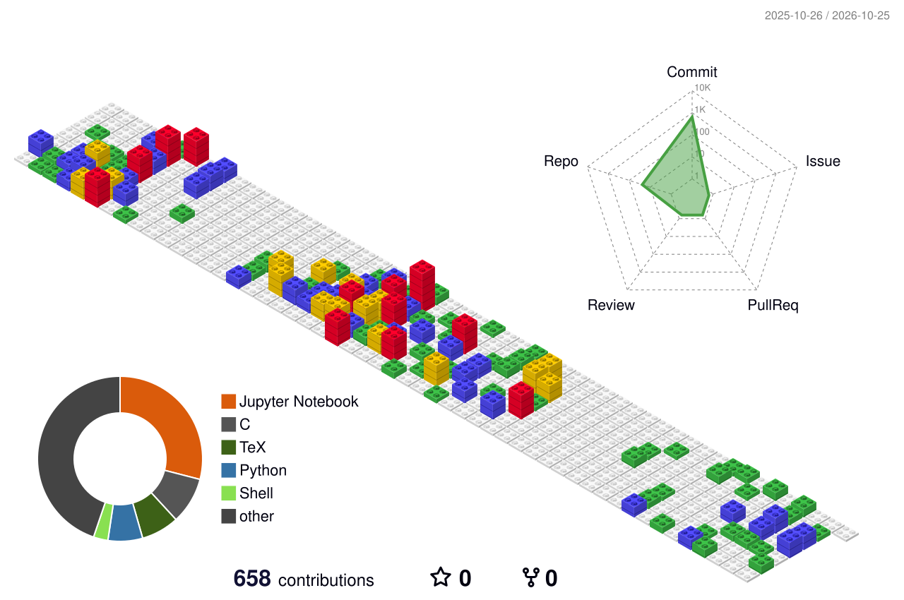

<h1 align="center"><b>Hi, I'm Shiwirockztar</b> </h1>

  

  
  
  
  

## About me

I am an Electronic Engineering and Computer Science student interested in building useful software and understanding how systems work from the interface to the hardware. I enjoy learning through practical projects in web development, artificial intelligence, networking, embedded systems and cybersecurity.

## What I am exploring

- **Web development:** Angular, TypeScript, Java, Spring Boot and MySQL.
- **Artificial intelligence:** speech-to-text, image translation and creative tooling with notebooks.
- **Electronics and embedded systems:** KiCad, Arduino, ESP32-CAM, FPGA workflows, VHDL, Verilog and MQTT.
- **Systems and infrastructure:** Docker, Linux, networking labs and self-hosted tools.

## Featured projects

<table>
  <tr>
    <td width="50%">
      <h3><a href="https://github.com/shiwirockztar/Movie-SAM">Movie-SAM</a></h3>
      
Netflix-inspired application built with Spring Boot, Angular and MySQL.

      

    </td>
    <td width="50%">
      <h3><a href="https://github.com/shiwirockztar/Subtitle-IA-whisper">Subtitle IA Whisper</a></h3>
      
Notebook project focused on automatic subtitle generation with AI.

      

    </td>
  </tr>
  <tr>
    <td width="50%">
      <h3><a href="https://github.com/shiwirockztar/AI-Comic-Translator">AI Comic Translator</a></h3>
      
Exploration of artificial intelligence applied to comic translation.

      

    </td>
    <td width="50%">
      <h3><a href="https://github.com/shiwirockztar/DIgitales-TerosHDL-VHDL">TeroHDL + VHDL</a></h3>
      
FPGA development environment with VHDL, Verilog, GHDL and ModelSim.

      

    </td>
  </tr>
  <tr>
    <td width="50%">
      <h3><a href="https://github.com/shiwirockztar/CameraWebServer_ESP32-CAM">ESP32-CAM</a></h3>
      
Embedded camera experiments and web server development with ESP32-CAM.

      

    </td>
    <td width="50%">
      <h3><a href="https://github.com/shiwirockztar/Angular-Movie-Website">Angular Movie Website</a></h3>
      
Responsive movie website built while strengthening front-end skills.

      

    </td>
  </tr>
</table>

## Electronics and engineering projects

<table>
  <tr>
    <td width="50%">
      <h3><a href="https://github.com/shiwirockztar/Kicad">KiCad with Docker</a></h3>
      
Electronic design workflow and KiCad setup inside a reproducible Docker environment.

      

    </td>
    <td width="50%">
      <h3><a href="https://github.com/shiwirockztar/CameraWebServer_ESP32-CAM">Arduino and ESP32-CAM</a></h3>
      
Embedded camera experiments combining microcontrollers, C and web server concepts.

      

    </td>
  </tr>
  <tr>
    <td width="50%">
      <h3><a href="https://github.com/shiwirockztar/WatsWatch">MQTT and IoT</a></h3>
      
MQTT and WhatsApp communication experiment developed with C++.

      

    </td>
    <td width="50%">
      <h3><a href="https://github.com/shiwirockztar/DIgitales-TerosHDL-VHDL">FPGA, VHDL and Verilog</a></h3>
      
Digital design workflow with TeroHDL, VHDL, Verilog, GHDL and ModelSim.

      

    </td>
  </tr>
  <tr>
    <td width="50%">
      <h3><a href="https://github.com/shiwirockztar/Redes-de-Computadores-2">Computer networks</a></h3>
      
Networking laboratory work with routing, switching and Cisco technologies.

      

    </td>
    <td width="50%">
      <h3><a href="https://github.com/shiwirockztar/Sistemas-de-Control-Continuo">Control systems</a></h3>
      
Continuous control systems and engineering simulations developed with notebooks.

      

    </td>
  </tr>
</table>

<a href="https://github.com/shiwirockztar?tab=repositories"><b>Explore all my repositories &gt;</b></a>

## Technologies

  

  
  
  
  

## 3D contribution profile

  

## GitHub activity

  
  

  

  

  <i>Thanks for visiting my profile. I am always open to learning, building and collaborating.</i>

